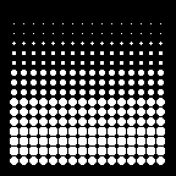

# gb-tixy

A clone of [tixy.land](https://tixy.land) for the Game Boy and Game Boy Color.

A 16×16 grid of circles, each driven by one expression of `t`, `i`, `x`, `y`.
Positive values draw white circles, negative values draw red ones, and the
size follows the magnitude. See [tixy.md](tixy.md) for the original.

## Controls

Formulas are RPN programs you can edit on the Game Boy itself. The top row
shows the formula number, mode and frames per update; the bottom row shows
the program.

| Button      | Run mode         | Edit mode                                  |
|-------------|------------------|--------------------------------------------|
| Left/Right  | previous/next    | move the cursor                            |
| Up/Down     |                  | change the token (or the number, 0..127)   |
| Select      |                  | switch the token between number and op     |
| A           | next formula     | insert a copy of the token after it        |
| B           | previous formula | delete the token                           |
| Start       | edit             | run                                        |

Directions repeat while held. The grid updates live while you edit; `err`
means the program doesn't leave a value on the stack. Edits last until power
off.

In the SDL preview: arrows, Space/Z = A, X = B, Enter = Start,
Backspace = Select, Esc quits.

## Building (macOS)

Needs [GBDK-2020](https://github.com/gbdk-2020/gbdk-2020/releases) (found via
`$GBDK_HOME`, `PATH`, or `~/opt/gbdk`), Homebrew `sdl2`, and optionally
[SameBoy](https://sameboy.github.io) and `ffmpeg`.

    ./build.py          # build/tixy.gb
    ./build.py run      # build and open in SameBoy
    ./build.py sdl      # desktop preview
    ./build.py watch    # rebuild on change (watch sdl restarts the preview)
    ./build.py gif      # re-record docs/tixy.gif

The ROM is CGB-compatible: colour on a Game Boy Color, greys on the original.

## Writing formulas

A formula is a postfix program over `t`, `i`, `x`, `y`. `Math.sin(y/8+t)` is

    y 5 * t + sin

| Tokens                                  | Meaning                                     |
|-----------------------------------------|---------------------------------------------|
| `t x y i`, `0`..`127`                   | push a value                                |
| `sin cos tan atan sqrt neg abs`         | unary, table lookups                        |
| `+ - * / % & \| ^ << >>`                | binary (`/ %` by 0 give 0)                  |
| `< > =`                                 | compare: 127 (full circle) or 0             |
| `?`                                     | `c a b ?` is `c ? a : b`                    |
| `dup swap`                              | stack                                       |

Everything is 8-bit: values are `i8` (−128..127, wrapping), ±127 is a full
size circle, and `t` counts frames (60 a second). Angles are in units where
128 = π, so a full turn is 256 and wraps for free; to port a tixy
expression, convert radians, e.g. `y/8` rad ≈ `y 5 *`.

The built-in gallery is the `gallery[]` list of RPN strings in `src/main.c`.

## How it works

`src/build_tables.c` runs at build time and generates the trig tables, 13
circle tiles plus a value→tile table, and a small font.

The interpreter (`src/rpn.h`) runs a program one token at a time across the
whole grid rather than once per cell: each stack slot is either a single
value (`t`, numbers) or 256 values, so the per-token dispatch happens a few
times a frame and the work is plain loops. Programs that only depend on `t`
are computed once per frame.

On the Game Boy that runs at roughly 3–35 fps depending on the program (the
top-right counter shows frames per update); the inner loops are still plain
SDCC output.

The same `main.c` builds for the Game Boy with GBDK or for the desktop with
`-DSDL`, through a small shim (`src/shim_sdl.h`) that emulates the few GBDK
calls used.
